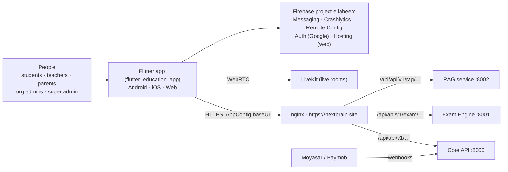
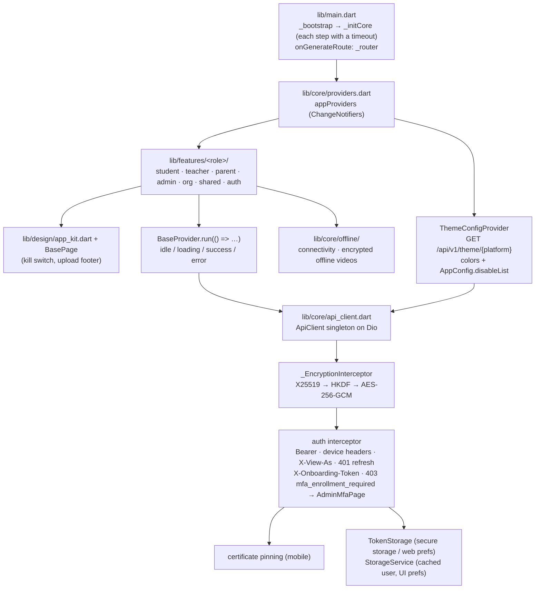
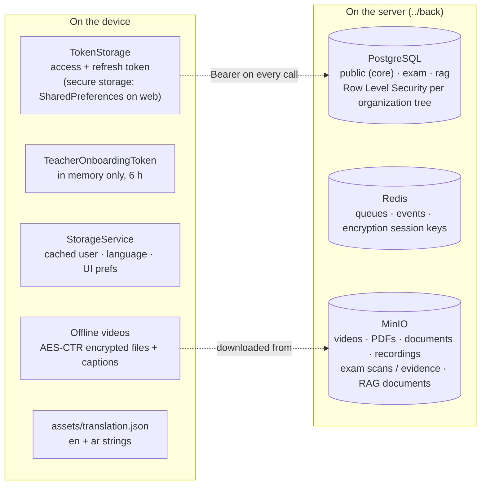
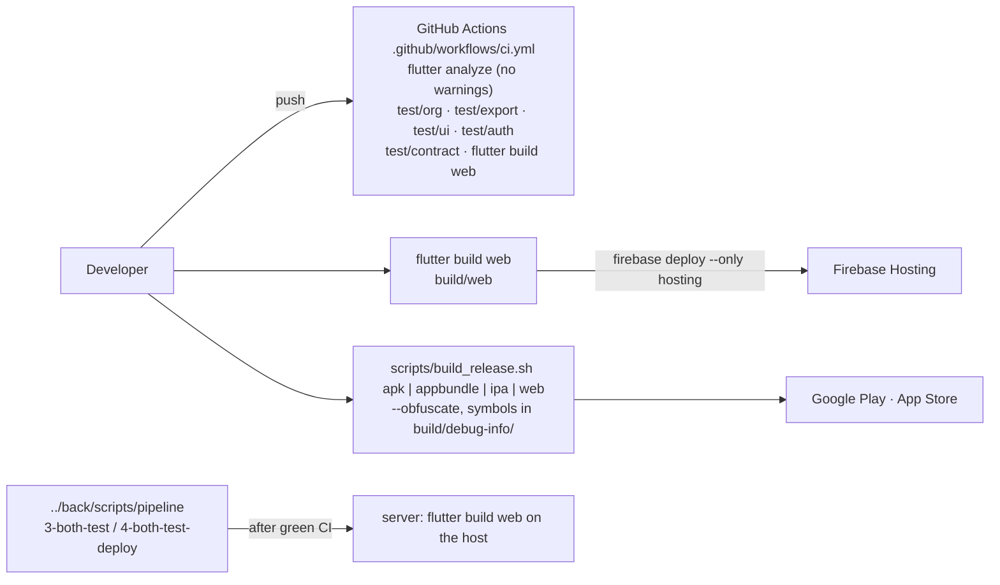

# Architecture (Flutter app)

The big picture of the NextBrain app and the services it talks to, for a developer on day one. The illustrated
version, with videos, is `documents/01_Platform_Overview.docx` / `.pptx` (regenerate with
`documents/_build/build_platform.py`; see `documents/README.md`). The backend's own view, with every container and
schema, is `../back/docs/ARCHITECTURE.md`. Conventions and commands: `CLAUDE.md`.

## 1. System context



## 2. Inside the app (containers and layers)



Ports and services behind nginx: core `api` 8000 (everything under `/api/v1/…` except the two below), Exam Engine
8001 (`/api/v1/exam/…`, client `lib/features/shared/exam_engine/exam_engine_api.dart`), RAG 8002 (`/api/v1/rag/…`,
`lib/features/shared/rag/`). The app sends every path in full on top of `AppConfig.baseUrl`
(`https://nextbrain.site/api`, or `--dart-define=API_BASE_URL=…` for a dev build), so requests reach nginx as
`/api/api/v1/…`: `/api/api/v1/exam/…` and `/api/api/v1/rag/…` go to the engine and RAG with the extra `/api` cut, and
everything else goes to the core with the first `/api` stripped (`../back/docs/DEPLOY.md`,
`../back/deploy/nginx/nextbrain.conf.example`).

## 3. Data stores



The server stores naive UTC; the app shows every time through `AppTime` (platform or organization timezone,
12h/24h). Refresh tokens rotate: `POST /api/v1/auth/refresh` returns a new pair and the old one is dead.

## 4. A request, end to end

```mermaid
sequenceDiagram
    autonumber
    participant UI as Screen
    participant P as Provider (BaseProvider)
    participant C as ApiClient
    participant N as nginx
    participant S as Core API
    participant DB as PostgreSQL
    UI->>P: user action
    P->>C: run(() => ApiClient().post('/api/v1/…', body))
    C->>C: encrypt body {"n","ct"} + X-Enc-Session, then Bearer + device headers
    C->>N: HTTPS (Android/iOS accept only the pinned certificate)
    N->>S: strip /api, forward
    S->>S: decrypt · rate limit · device / subscription / orgs guards · org_ctx permission
    S->>DB: SQL as nextbrain_app, RLS limited to the organization tree
    DB-->>S: rows
    S-->>C: encrypted envelope
    C->>C: decrypt; 401 → refresh once and retry; encryption_session_expired → new handshake and retry
    C-->>P: data, or ApiException (message safe to show, code e.g. DEVICE_MISMATCH)
    P-->>UI: notifyListeners()
```

## 5. Deployment



## Rules that keep the architecture intact

- Every API call goes through `ApiClient` (never a second `Dio` to the API host: pinning and encryption live there).
- New global state is registered in `lib/core/providers.dart`; feature providers extend `BaseProvider`.
- New screens use `lib/design/app_kit.dart` and `BasePage`; strings go to `assets/translation.json` (en + ar) or
  `t(ar, en)` in org screens; layouts pass `test/ui/layout_harness.dart`.
- Every `ApiClient` call (core, Exam Engine and RAG) is resolved by `test/contract/api_call_scan.dart` and checked
  against the server's route snapshot by `test/contract/api_paths_test.dart`
  (`../back/scripts/contract/export_api_paths.py --front ../nextbrain-front` refreshes it).
- Code that is not web-safe sits behind `kIsWeb` or conditional imports.

## Phase 10 in the app

```mermaid
sequenceDiagram
    autonumber
    participant L as LoginScreen / Google flow
    participant A as MyAuthProvider
    participant C as ApiClient
    participant S as Core API
    L->>A: login(gmail, password)
    A->>C: POST /api/v1/auth/login
    C->>S: (envelope-encrypted)
    S-->>C: {mfa_required, mfa_token} or {mfa_enrollment_required, mfa_enroll_token}
    A-->>L: openMfaStep
    L->>A: code (MfaVerifyScreen) or enrol (AdminMfaPage)
    A->>C: POST /api/v1/auth/mfa/verify (or /mfa/setup + /mfa/confirm)
    S-->>C: access + refresh token (+ onboarding_token for a teacher still onboarding)
    A->>A: completeSession: store the pair; TeacherOnboardingToken keeps the onboarding token in memory
```

- **MFA** (back D-027, app D-006, D-009): `lib/features/auth/mfa.dart`, `mfa_verify_screen.dart`,
  `lib/features/admin/admin_mfa_page.dart` (tile in the admin services hub; super-admin reset on the admin and user
  lists), `lib/features/auth/mfa_entry.dart` (`MfaSettingsEntry` on the profile and the org settings page, shown when
  the server allows MFA for the role, feature key `profile.mfa`). A 403 `mfa_enrollment_required` opens the page; after
  it is dismissed it reopens on a later 403 only after 30 s (`mfaPromptCooldown`).
- **Teacher onboarding token** (back D-028): `lib/features/auth/teacher_onboarding_token.dart`; `ApiClient` adds
  `X-Onboarding-Token` to every onboarding route.
- **Download my data** (back D-029): `lib/features/shared/profile/privacy_export.dart`, feature key
  `profile.data_export`.
- **Organization status and quotas** (back D-032): exam and RAG screens map `orgs_disabled`, `org_not_approved`,
  `org_inactive` and `rag_quota_exceeded` (`exam_taking.dart`, `rag_library.dart`, `rag_chat.dart`); the library
  shows `RagQuotaBar`.
- **API base URL** (D-008, D-009): `resolveApiBaseUrl` — a release build accepts only an `https://` override,
  otherwise it talks to production.
- **Admin money and RAG quota** (D-009): the refund sheet handles 409 `refund_external_recorded` and the cards show
  refunded / refundable (`admin_money_p8.dart`, `admin_finance_page.dart`); the Super Admin sets a library quota per
  organization from the organization review sheet (`lib/features/shared/rag/rag_quota_admin.dart`).
- **Transport** (D-005, D-009): `android/app/src/main/res/xml/network_security_config.xml` (cleartext only for
  loopback — the offline-video server — and the emulator host) is prepared but not referenced by the manifest yet;
  `usesCleartextTraffic` / `NSAllowsArbitraryLoads` stay until the server's media URLs are confirmed https.
- **Server side, not visible in the app:** per-service database / MinIO credentials, evidence encryption, metrics and
  alerts (`mlops/`), backups with a tested restore, the capacity budget — see `../back/docs/ARCHITECTURE.md`.
- **Local stack:** `../back/scripts/dev/setup.sh` (or `setup.ps1`) starts the backend with demo data; run the app with
  `--dart-define=API_BASE_URL=http://10.0.2.2:18080/api` (Android emulator) or the host's address.
