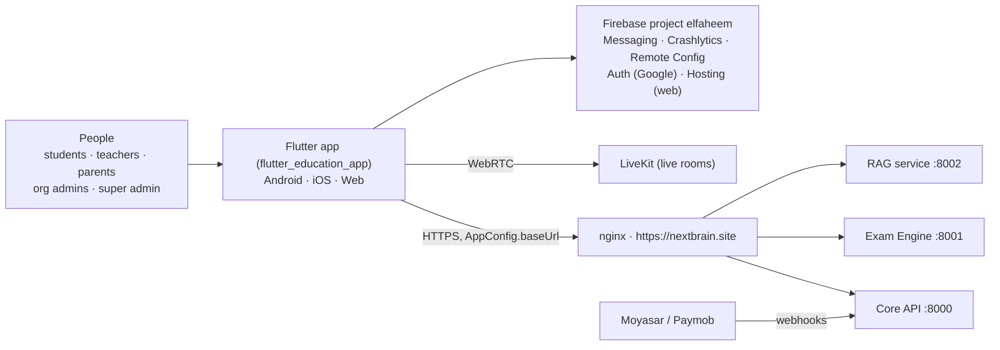
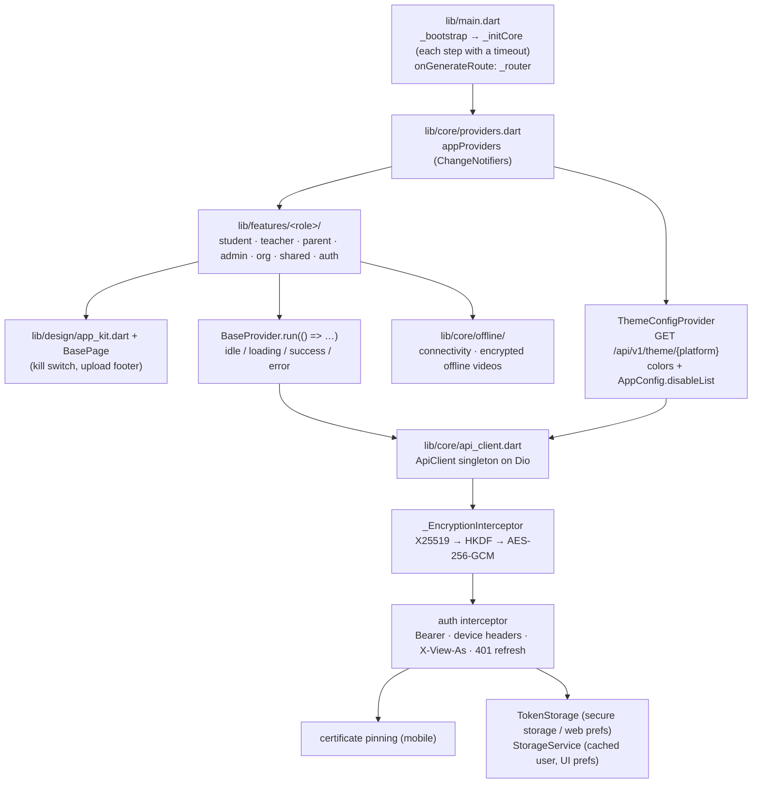
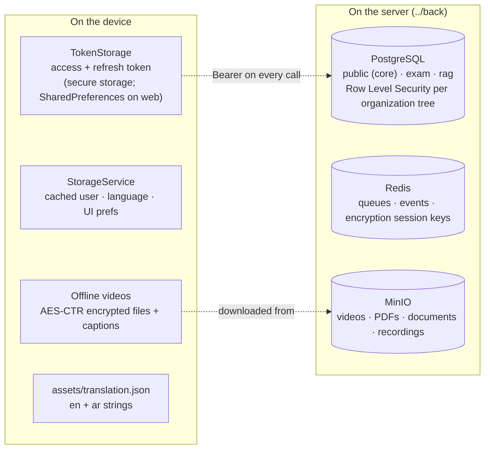
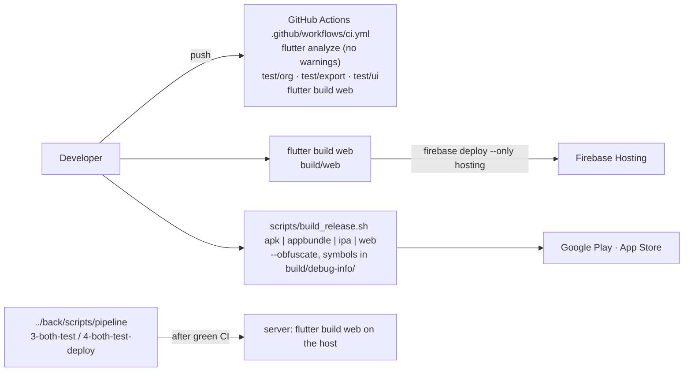

# Architecture (Flutter app)

The big picture of the NextBrain app and the services it talks to, for a developer on day one. The illustrated
version, with videos, is `documents/01_Platform_Overview.docx` / `.pptx` (regenerate with
`documents/_build/build_platform.py`; see `documents/README.md`). The backend's own view, with every container and
schema, is `../back/docs/ARCHITECTURE.md`. Conventions and commands: `CLAUDE.md`.

## 1. System context



## 2. Inside the app (containers and layers)



Ports and services behind nginx: core `api` 8000 (everything under `/api/v1/…` except the two below), Exam Engine
8001 (`/api/v1/exam/…`, client `lib/features/shared/exam_engine/exam_engine_api.dart`), RAG 8002 (`/api/v1/rag/…`,
`lib/features/shared/rag/`). The app sends every path in full on top of `AppConfig.baseUrl`
(`https://nextbrain.site/api`); nginx strips that prefix and routes by path.

## 3. Data stores



The server stores naive UTC; the app shows every time through `AppTime` (platform or organization timezone,
12h/24h). Refresh tokens rotate: `POST /api/v1/auth/refresh` returns a new pair and the old one is dead.

## 4. A request, end to end

```mermaid
sequenceDiagram
    autonumber
    participant UI as Screen
    participant P as Provider (BaseProvider)
    participant C as ApiClient
    participant N as nginx
    participant S as Core API
    participant DB as PostgreSQL
    UI->>P: user action
    P->>C: run(() => ApiClient().post('/api/v1/…', body))
    C->>C: encrypt body {"n","ct"} + X-Enc-Session, then Bearer + device headers
    C->>N: HTTPS (Android/iOS accept only the pinned certificate)
    N->>S: strip /api, forward
    S->>S: decrypt · rate limit · device / subscription / orgs guards · org_ctx permission
    S->>DB: SQL as nextbrain_app, RLS limited to the organization tree
    DB-->>S: rows
    S-->>C: encrypted envelope
    C->>C: decrypt; 401 → refresh once and retry; encryption_session_expired → new handshake and retry
    C-->>P: data, or ApiException (message safe to show, code e.g. DEVICE_MISMATCH)
    P-->>UI: notifyListeners()
```

## 5. Deployment



## Rules that keep the architecture intact

- Every API call goes through `ApiClient` (never a second `Dio` to the API host: pinning and encryption live there).
- New global state is registered in `lib/core/providers.dart`; feature providers extend `BaseProvider`.
- New screens use `lib/design/app_kit.dart` and `BasePage`; strings go to `assets/translation.json` (en + ar) or
  `t(ar, en)` in org screens; layouts pass `test/ui/layout_harness.dart`.
- Exam Engine and RAG paths are checked against the server's route snapshot by `test/contract/api_paths_test.dart`
  (`../back/scripts/contract/export_api_paths.py --front ../nextbrain-front` refreshes it).
- Code that is not web-safe sits behind `kIsWeb` or conditional imports.

## Coming in Phase 10 (in progress, not available yet)

MFA for admins, data-subject export, metrics, backups, quotas, dedicated service credentials, seed data and a
one-command local setup. This file will be updated when they land.
